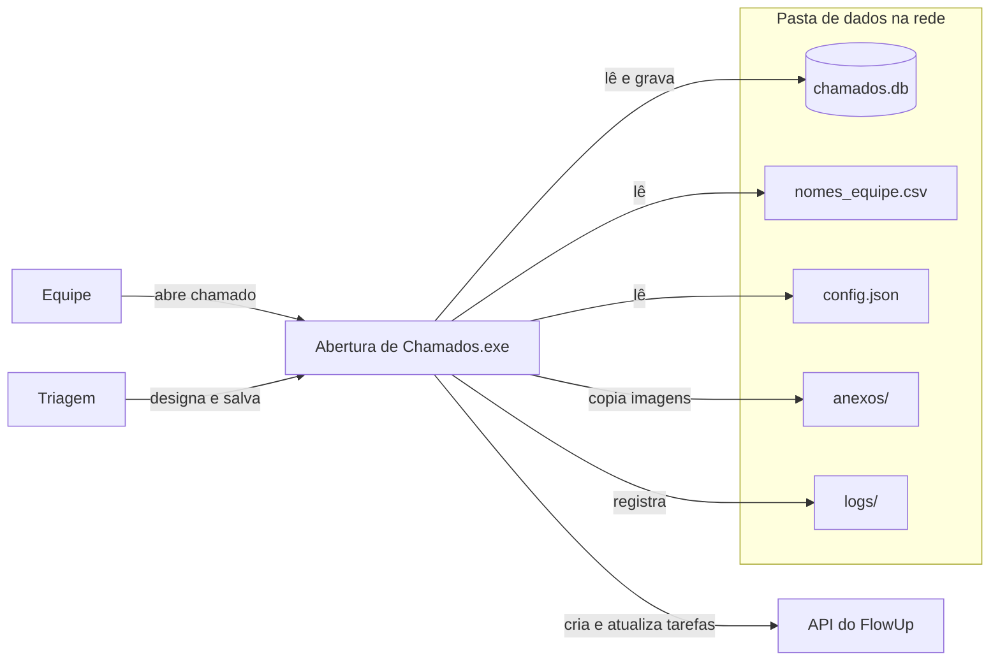

# Arquitetura

Este documento descreve como o programa está montado e quais regras ele segue. Para alterar valores (IDs do FlowUp, token, lista da equipe), veja [configuracao.md](configuracao.md).

## Visão geral

É um programa de desktop em Python (CustomTkinter), distribuído como um único `.exe` gerado pelo PyInstaller. Não existe servidor: cada pessoa roda a própria cópia do exe, e todas as cópias usam a mesma pasta de dados na rede.

## Módulos

| Arquivo | Responsabilidade |
|---|---|
| `Bugs.py` | Ponto de entrada. Configura o log, mostra a tela de carregamento, cria a tabela se preciso, lê a lista da equipe e abre a tela inicial com os três botões. O nome vem da primeira versão (formulário de bugs) e foi mantido porque o `.spec` e os atalhos dependem dele. |
| `janelas.py` | Telas: carregamento, aba "Novo chamado" (abertura e encaminhamento) e aba "Chamados" (lista e detalhes). |
| `tema.py` | Identidade visual: cores (claro, escuro), fonte Franklin Gothic Book, título com listra, rodapé, botões e campos. |
| `servico.py` | Regras da integração: montar os dados, criar ou atualizar a tarefa, excluir chamado e tarefa. |
| `equipe.py` | Sincroniza o `nomes_equipe.csv` com os usuários ativos do FlowUp a cada abertura. |
| `database.py` | Todas as consultas ao SQLite. Nenhum outro módulo escreve SQL. |
| `flowup_api.py` | Chamadas HTTP ao FlowUp. Trata redirecionamento, token recusado e falta de conexão e devolve mensagens curtas. |
| `config.py` | Versão do programa, local da pasta de dados, leitura do `config.json`, valores padrão do FlowUp e configuração do log. |
| `ferramentas/diagnostico_flowup.py` | Verificação da integração, para uso de quem mantém o sistema. Não faz parte do exe. |

## Telas

> A partir da versão 2.1 as telas abaixo ficam numa janela só: a aba "Novo chamado" junta a abertura e o encaminhamento, e a aba "Chamados" junta a lista e o acompanhamento (com o botão Excluir). As regras descritas continuam valendo.

### Tela inicial
Botões "1 - Abrir Chamado", "2 - Acompanhar Chamado" e "3 - Ver Todos os Chamados", e a chave de modo escuro. A versão aparece na barra de título, por exemplo `Sistema de Chamados (v2.0.0)`.

Antes dela aparecem duas telas de carregamento: a do PyInstaller (imagem `matriz/tela_abertura.png`, enquanto o exe se descompacta) e a do próprio programa, com frases aleatórias, enquanto o banco e a lista da equipe são lidos da rede. Se a rede não responder, a tela inicial abre mesmo assim e mostra o erro.

### Abrir Chamado (`AbrirChamadoWindow`)
- Campos obrigatórios: nome, software e tema. Ferramenta, descrição e imagem são opcionais.
- As opções de software e ferramenta estão no dicionário `tool_options` (ver [configuracao.md](configuracao.md#opções-de-software-e-ferramenta)).
- A imagem anexada é copiada para `anexos\` na pasta de dados com o nome `<protocolo>_<nome original>`. No banco fica o caminho relativo (`anexos\C034_print.png`).

### Acompanhar Chamado (`AcompanharChamadoWindow`)
- Busca pelo protocolo e mostra o resumo, a imagem (clique abre no visualizador do Windows) e os campos de triagem: designado por, responsável, data de entrega, status e observações.
- **Designar Chamado** fica ativo enquanto o chamado não tem responsável; depois disso o ativo é **Salvar Modificações**. Os dois executam a mesma rotina (`salvar_alteracoes`).
- **Fechar Chamado** só fica ativo com status Solucionado ou Não solucionado.
- O responsável é obrigatório para salvar, porque toda tarefa do FlowUp precisa de um.

### Ver Todos os Chamados (`ListarChamadosWindow`)
Lista com filtros por status, software, solicitante e responsável, botão "Ver Detalhes" (abre o acompanhamento do chamado) e exportação para CSV (UTF-8 com BOM, abre direto no Excel) com todas as colunas do banco.

## Dados

### Pasta de dados

Padrão: `Z:\Biblioteca\Padronização\Cadari\Processos BIM\Formulário de bugs\Banco de dados` (definido em `config.py`, pode ser trocado pela variável `CHAMADOS_PASTA_DADOS`).

| Item | Conteúdo |
|---|---|
| `chamados.db` | Banco SQLite com todos os chamados |
| `nomes_equipe.csv` | Pessoas que aparecem nas listas e o ID de cada uma no FlowUp |
| `config.json` | Token e IDs do FlowUp |
| `anexos\` | Imagens anexadas aos chamados (criada no primeiro anexo) |
| `logs\` | Um arquivo por usuário e mês, `AAAA-MM_<usuário do Windows>.log` |
| `icone.ico`, `Tela abertura.png` | Restos da versão 1.x: o exe antigo lê o `icone.ico` daqui e a compilação antiga usava os dois. As cópias atuais estão em `matriz/`. Podem ser apagados quando todos estiverem na 2.0 |

### Tabela `chamados`

| Coluna | Tipo | Conteúdo |
|---|---|---|
| `id` | inteiro | Chave automática |
| `protocolo` | texto, único | `C` + id com três dígitos (C001...C999, depois C1000) |
| `nome_solicitante` | texto | Nome escolhido na abertura (vem do `nomes_equipe.csv`) |
| `software`, `ferramenta`, `tema` | texto | Classificação e título do chamado |
| `descricao` | texto | Descrição livre |
| `data_hora` | timestamp | Abertura, gravada em UTC pelo SQLite. As telas mostram no horário de Brasília |
| `status` | texto | Não visto, Visto, Em execução, Solucionado, Não solucionado ou Fechado |
| `designado_por`, `responsavel` | texto | Nomes da lista da equipe |
| `data_entrega` | data | `AAAA-MM-DD` |
| `observacoes` | texto | Observações da triagem |
| `ultima_alteracao_por` | texto | Usuário do Windows que salvou por último |
| `caminho_imagem` | texto | Caminho do anexo, relativo à pasta de dados (absoluto em registros antigos) |
| `flowup_task_id` | inteiro | Número da tarefa no FlowUp. Vazio = tarefa ainda não criada |

Os nomes são gravados como texto. Se uma pessoa for renomeada no `nomes_equipe.csv`, os chamados antigos continuam com o nome antigo.

## Integração com o FlowUp

API pública: `https://api.flowup.me/v1/...`, documentação em https://api.flowup.me/swagger. Autenticação por token Bearer (ver [configuracao.md](configuracao.md#token-do-flowup)).

### Quando cada chamada acontece

| Ação na tela | Condição | Chamada |
|---|---|---|
| Salvar (Designar ou Salvar Modificações) | chamado sem `flowup_task_id` | `POST /v1/Task/Create` e grava o número devolvido em `flowup_task_id` |
| Salvar | chamado com `flowup_task_id` | `PUT /v1/Task/Update` |
| Fechar Chamado | chamado com `flowup_task_id` | `PUT /v1/Task/Update` com o status configurado para "Fechado" |

O banco é gravado **antes** da chamada à API. Se o FlowUp falhar, o chamado fica salvo, a mensagem de erro explica o motivo e basta salvar de novo para tentar outra vez. A decisão entre criar e atualizar olha só o `flowup_task_id`; até a versão 1.x ela olhava o responsável, o que impedia nova tentativa depois de uma falha (ver o histórico em [manutencao-e-problemas.md](manutencao-e-problemas.md#histórico-de-incidentes)).

### Dados enviados

| Campo do FlowUp | Valor |
|---|---|
| `Title` | `Chamado <protocolo> - <tema>` |
| `ProjectId`, `BoardId` | `projeto_id` e `quadro_id` do `config.json` (151 e 2271) |
| `StatusId` | status escolhido na tela, convertido pela tabela abaixo |
| `UserId` | ID do responsável no `nomes_equipe.csv` |
| `FollowerUsers` | ID do solicitante (se estiver na lista) + `seguidores_fixos` do `config.json` |
| `StartDate`, `EndDate` | dia da entrega, das 08:00 às 18:00. Sem data, o momento do salvamento |
| `Tags` | tag "Chamados" (`tag` do `config.json`) |
| `Description` | protocolo, solicitante, software, ferramenta, descrição e observações da triagem, em HTML simples (desde a 2.1) |
| `Comments` | vazio (a API ignora este campo) |

Os demais campos (`IsGantt`, `IgnoreHours`, `EstimatedEffort`, `FollowerTeams`, `ServiceId`...) repetem os valores aceitos pela API desde a primeira versão da integração.

### Status

Desde a versão 2.2 o programa usa os mesmos status do quadro do FlowUp, lidos a cada abertura (`servico.carregar_status`). Se o FlowUp não responder, valem os do `config.json`.

| Status | ID no quadro 2271 |
|---|---|
| Novas | 11583 |
| Em andamento | 11585 |
| Pendência Interna | 11677 |
| Finalizadas (final) | 11584 |

Chamados gravados com os status antigos são convertidos ao abrir o programa (`database.STATUS_ANTIGOS`): Não visto e Visto viram Novas, Em execução vira Em andamento, Solucionado e Fechado viram Finalizadas, Não solucionado vira Pendência Interna.

### O que a integração não faz
- Não lê nada de volta do FlowUp. Se alguém mudar o status ou o responsável direto no FlowUp, o programa não fica sabendo.
- Não envia a imagem anexada.
- Não apaga tarefas. Se uma tarefa for apagada no FlowUp, a próxima atualização daquele chamado devolve "Tarefa não encontrada" (já acontece com C021 e C022).

## Log

`configurar_log()` (em `config.py`) grava em `logs\AAAA-MM_<usuário>.log` na pasta de dados; se a rede não estiver acessível, usa `%TEMP%\chamados_logs`. Ficam registrados: a abertura do programa com a versão, cada chamada ao FlowUp com o código HTTP e o início da resposta, e qualquer erro, inclusive os que acontecem dentro das telas.

## Limitações conhecidas

- **SQLite em pasta de rede.** Funciona para o volume atual (dezenas de chamados por ano, poucas gravações simultâneas), mas o SQLite não foi feito para acesso concorrente por rede. Evite deixar o banco aberto no DB Browser enquanto a equipe usa o programa e mantenha backup ([manutencao-e-problemas.md](manutencao-e-problemas.md#backup)).
- **Token legível por quem acessa o Z:.** O `config.json` precisa ser lido pelo exe de cada pessoa. Quem tem acesso à pasta consegue ver o token.
- **Interface e rede na mesma linha de execução.** As chamadas ao FlowUp travam a janela por alguns segundos (no máximo `timeout_segundos`).
